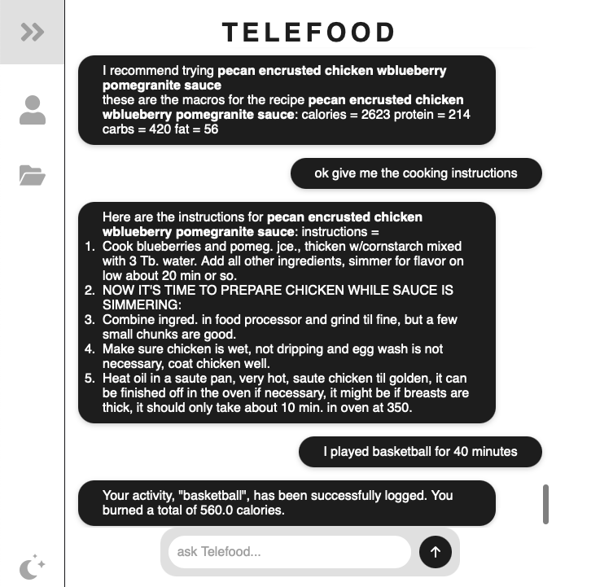
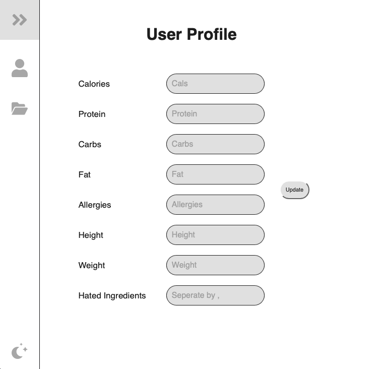

# Telefood

**Telefood** is a smart, AI-powered fitness app that helps you take control of your health. Built on Large Language Model (LLM) technology, Telefood enables users to track their nutrition, receive intelligent recipe recommendations, and stay motivated on their fitness journey.


<p float="left">
  
  
</p>


---

## Installation and Getting Started

1. Make sure you have a current Python version installed (Python 3.8 or higher recommended).

2. Clone the repository:
    ```sh
    git clone https://git.uni-regensburg.de/lub02070/recchat
    ```

3. Navigate to the project directory:
    ```sh
    cd recchat
    ```

4. Create and activate a virtual environment:

   - **Windows (CMD or PowerShell):**
     ```sh
     python -m venv venv
     venv\Scripts\activate
     ```

   - **macOS / Linux:**
     ```sh
     python3 -m venv venv
     source venv/bin/activate
     ```

5. Install dependencies:
    ```sh
    pip install -r requirements.txt
    ```

6. Run the application:

   - **Windows:**
     ```sh
     cd src
     python app.py
     ```

   - **macOS / Linux:**
     ```sh
     cd src
     python3 app.py
     ```

7. Login to the sample user account:  
   Username: `alw`  
   Password: `1234`